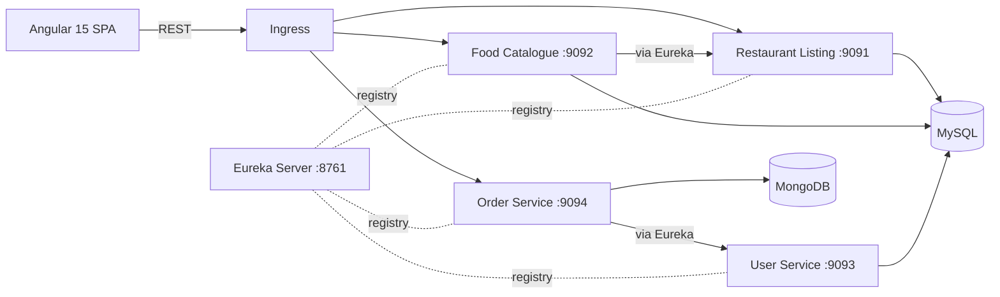

# FoodSwift — Cloud-Native Food Delivery Platform

A microservices-based food delivery platform. Customers browse restaurants, view a restaurant's menu, and place orders through an Angular single-page app. The backend is split into independent Spring Boot services that discover each other through Eureka, each owning its own database, and the whole system is containerized with Docker and deployable on Kubernetes.

      

## Features

- Browse all restaurants and open a restaurant to see its food items
- Add items to an order and place it; the order stores the restaurant, items and user details
- Service discovery with **Netflix Eureka**; services call each other by name through a load-balanced `RestTemplate`
- **Database per service**: MySQL for restaurants, food items and users; MongoDB for orders
- Sequential order IDs generated through a MongoDB sequence collection
- Dockerfile and Jenkins pipeline per service (Maven build and test, Docker image build and push)
- Kubernetes manifests with StatefulSets for the databases, Deployments for the services, and an Ingress for routing

## Architecture



**Request flow when opening a restaurant:** the Angular app calls the Food Catalogue service, which loads the food items from its own database and asks the Restaurant Listing service (resolved through Eureka) for the restaurant details, then returns both in one response. When an order is placed, the Order service calls the User service for the customer details and saves the complete order in MongoDB.

## Services

| Service | Port | Data store | Responsibility |
|---|---|---|---|
| `eureka-service` | 8761 | n/a | Service registry / discovery |
| `restaurant-listing-service` | 9091 | MySQL `restaurantdb` | Restaurant data |
| `foodcatalogue-service` | 9092 | MySQL `foodcataloguedb` | Food items; combines food items with restaurant details |
| `user-service` | 9093 | MySQL `userdb` | User information |
| `order-service` | 9094 | MongoDB `orderdb` | Order creation and storage |
| `food-delivery-app` | 4200 (dev) | n/a | Angular 15 frontend |

## API

| Method | Endpoint | Description |
|---|---|---|
| GET | `/restaurant/fetchAllRestaurants` | List all restaurants |
| GET | `/restaurant/fetchById/{id}` | Get one restaurant |
| POST | `/restaurant/addRestaurant` | Add a restaurant |
| GET | `/foodCatalogue/fetchRestaurantAndFoodItemsById/{restaurantId}` | Restaurant details plus its food items |
| POST | `/foodCatalogue/addFoodItem` | Add a food item |
| GET | `/user/fetchUserById/{userId}` | Get a user |
| POST | `/user/addUser` | Add a user |
| POST | `/order/saveOrder` | Place an order |

## Tech Stack

**Backend:** Java 11, Spring Boot 2.7, Spring Cloud (Netflix Eureka), Spring Data JPA / Hibernate, Spring Data MongoDB, MapStruct, Lombok, Maven

**Frontend:** Angular 15, TypeScript, RxJS

**Data:** MySQL 8, MongoDB 7

**DevOps:** Docker, Kubernetes (Deployments, StatefulSets, Services, Ingress, Secrets), Jenkins, SonarQube and JaCoCo configured in the order service

## Project Structure

```
foodswift/
├── eureka-service/              # Service registry
├── restaurant-listing-service/  # Restaurants (MySQL)
├── foodcatalogue-service/       # Food items (MySQL)
├── user-service/                # Users (MySQL)
├── order-service/               # Orders (MongoDB)
├── food-delivery-app/           # Angular frontend
└── k8s/                         # Kubernetes manifests
```

## Getting Started

### Prerequisites

- JDK 11, Maven (or use the included `mvnw`)
- Node.js and npm (Angular 15)
- MySQL 8 and MongoDB running locally (Docker is the easiest way)

### 1. Start the databases

```bash
docker run -d --name mysql -p 3306:3306 -e MYSQL_ROOT_PASSWORD=root mysql:8.0
docker run -d --name mongo -p 27017:27017 mongo:7

docker exec -it mysql mysql -uroot -proot -e \
  "CREATE DATABASE restaurantdb; CREATE DATABASE foodcataloguedb; CREATE DATABASE userdb;"
```

Tables are created automatically by Hibernate (`ddl-auto: update`) and MongoDB collections on first write.

### 2. Run the services

Start Eureka first, then the others, each in its own terminal and with the `local` profile:

```bash
cd eureka-service && ./mvnw spring-boot:run
cd restaurant-listing-service && ./mvnw spring-boot:run -Dspring-boot.run.profiles=local
cd user-service && ./mvnw spring-boot:run -Dspring-boot.run.profiles=local
cd foodcatalogue-service && ./mvnw spring-boot:run -Dspring-boot.run.profiles=local
cd order-service && ./mvnw spring-boot:run -Dspring-boot.run.profiles=local
```

Open `http://localhost:8761` to confirm all four services are registered.

### 3. Run the frontend

```bash
cd food-delivery-app
npm install
npm start
```

The app runs at `http://localhost:4200`. API base URLs are set in `src/app/constants/url.ts`.

## Docker

Each service has its own Dockerfile. Build and run an image:

```bash
cd restaurant-listing-service
docker build -t foodswift/restaurant-listing-service .
docker run -p 9091:9091 \
  -e SPRING_DATASOURCE_URL=jdbc:mysql://host.docker.internal:3306/restaurantdb \
  -e SPRING_DATASOURCE_USERNAME=root -e SPRING_DATASOURCE_PASSWORD=root \
  foodswift/restaurant-listing-service
```

Database connections and the Eureka address are supplied through environment variables (`SPRING_DATASOURCE_*`, `SPRING_DATA_MONGODB_URI`, `EUREKA_CLIENT_SERVICEURL_DEFAULTZONE`), so the same image runs in every environment.

## Kubernetes

The `k8s/` folder contains manifests for a single-node cluster (k3s or Minikube):

| File | Contents |
|---|---|
| `00-namespace.yaml` | `food-delivery` namespace |
| `10-mysql.yaml`, `11-mongo.yaml` | Database StatefulSets with persistent volumes |
| `20-eureka.yaml` | Eureka server |
| `30-apps.yaml` | The four Spring Boot services |
| `40-ingress.yaml` | Ingress routing |

```bash
kubectl apply -f k8s/00-namespace.yaml

# credentials are created as Secrets and are not stored in the manifests
kubectl -n food-delivery create secret generic app-secrets \
  --from-literal=mysql-root-password=<password> \
  --from-literal=mongo-root-password=<password> \
  --from-literal=restaurant-db-password=<password> \
  --from-literal=food-db-password=<password> \
  --from-literal=user-db-password=<password> \
  --from-literal=order-db-password=<password>

kubectl -n food-delivery create secret generic mysql-init --from-file=init.sql
kubectl -n food-delivery create secret generic mongo-init --from-file=init-mongo.js

kubectl apply -f k8s/10-mysql.yaml -f k8s/11-mongo.yaml
kubectl apply -f k8s/20-eureka.yaml -f k8s/30-apps.yaml
kubectl apply -f k8s/40-ingress.yaml
```

### Running on Minikube

```bash
minikube start --memory=4096 --cpus=2
minikube addons enable ingress
# in k8s/40-ingress.yaml use ingressClassName: nginx and a local host such as foodswift.local
echo "$(minikube ip) foodswift.local" | sudo tee -a /etc/hosts
```

## CI/CD

Every service has a `Jenkinsfile` that builds and tests with Maven (`mvn clean verify`), builds the Docker image, and pushes it to Docker Hub with a build-number tag and `latest`.

## Roadmap

- JWT-based authentication and authorization (Spring Security) with a login flow in the Angular app
- API gateway in front of the services
- Centralized configuration
- Order status tracking and payments

## Author

**Sushant Nikam** — Java Full Stack Developer
